<p align="center">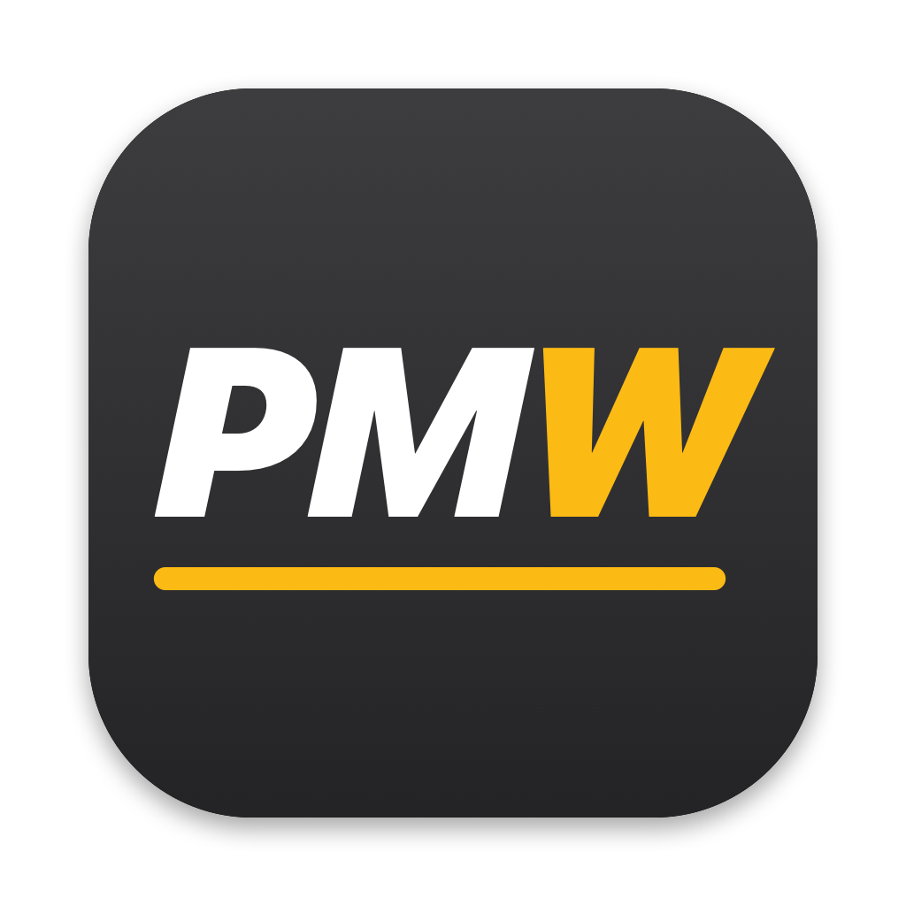</p>

# Pimp My Whoosh

A small macOS app that unlocks the hidden graphics and system settings of the **MyWhoosh** indoor cycling app on Mac, then launches the game with them applied.

MyWhoosh's own menu offers a handful of presets. Under the hood it is an Unreal Engine 5 game, and many more engine settings can be tuned through its configuration files. Pimp My Whoosh exposes them with allowed values only, shows what the game would use on its own, and explains what each one does.

<p align="center">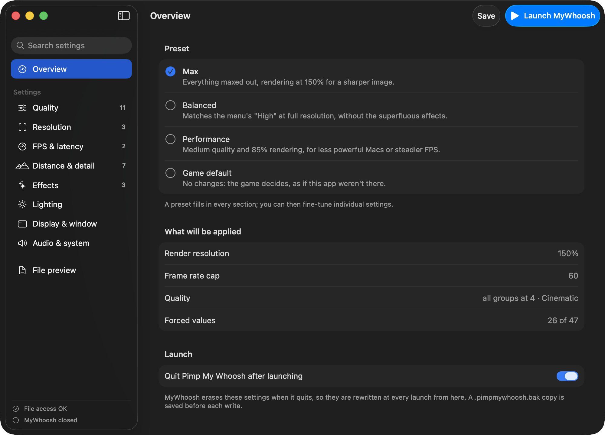</p>

| Quality groups up to Cinematic | Resolution and sharpening | Distance and detail |
|---|---|---|
| 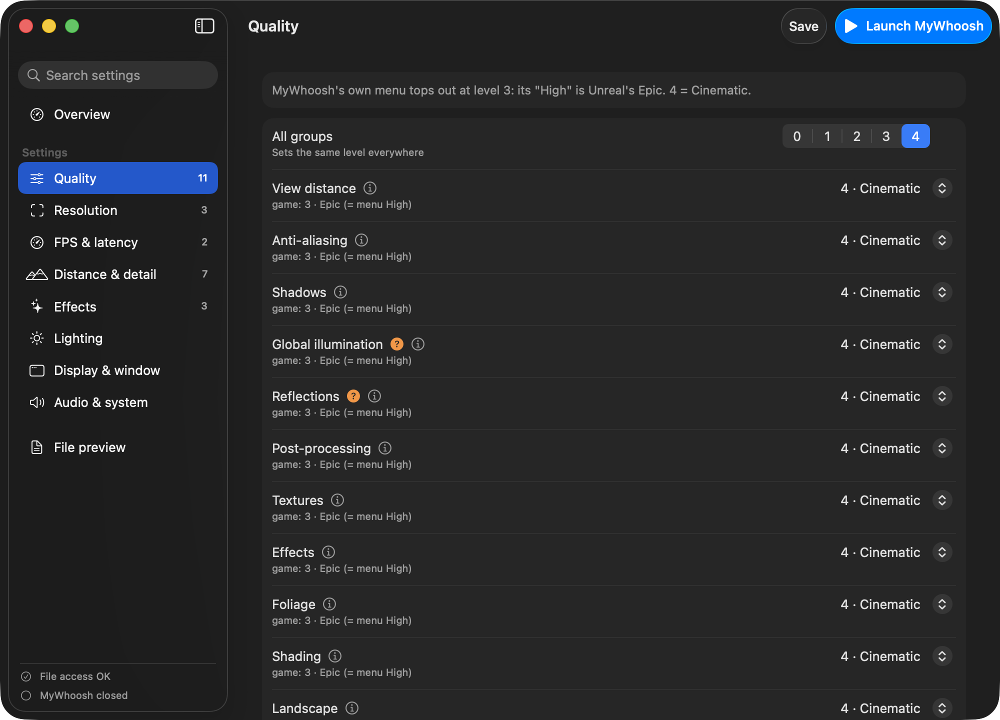 | 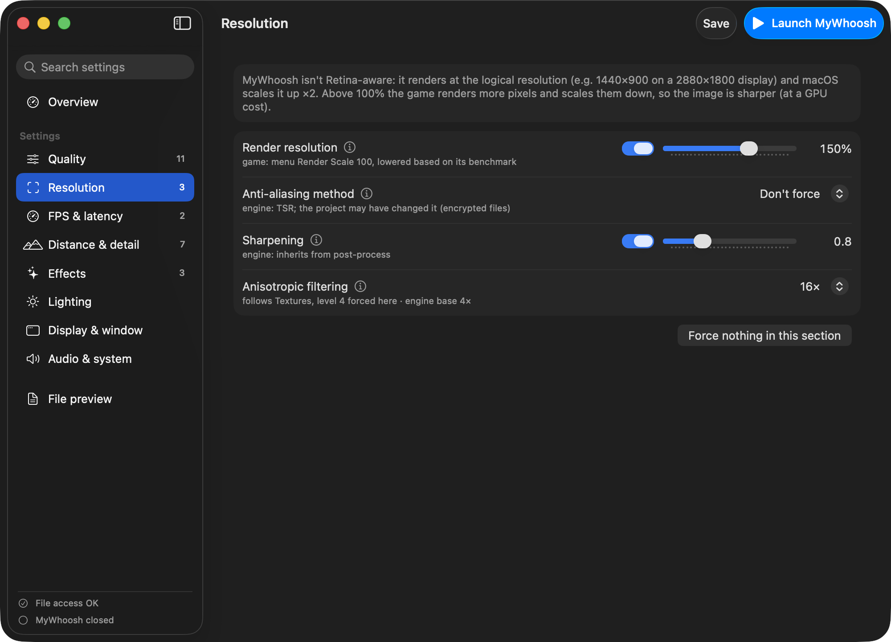 | 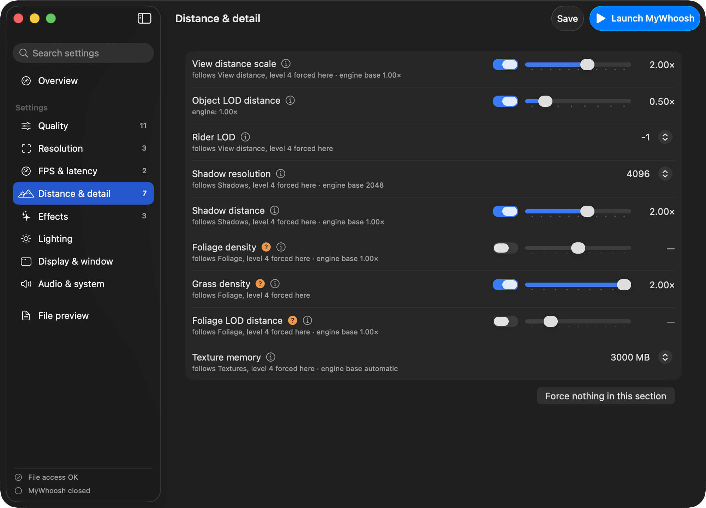 |

## Before and after

| Game's own highest settings | With Pimp My Whoosh (Max preset) |
|---|---|
| 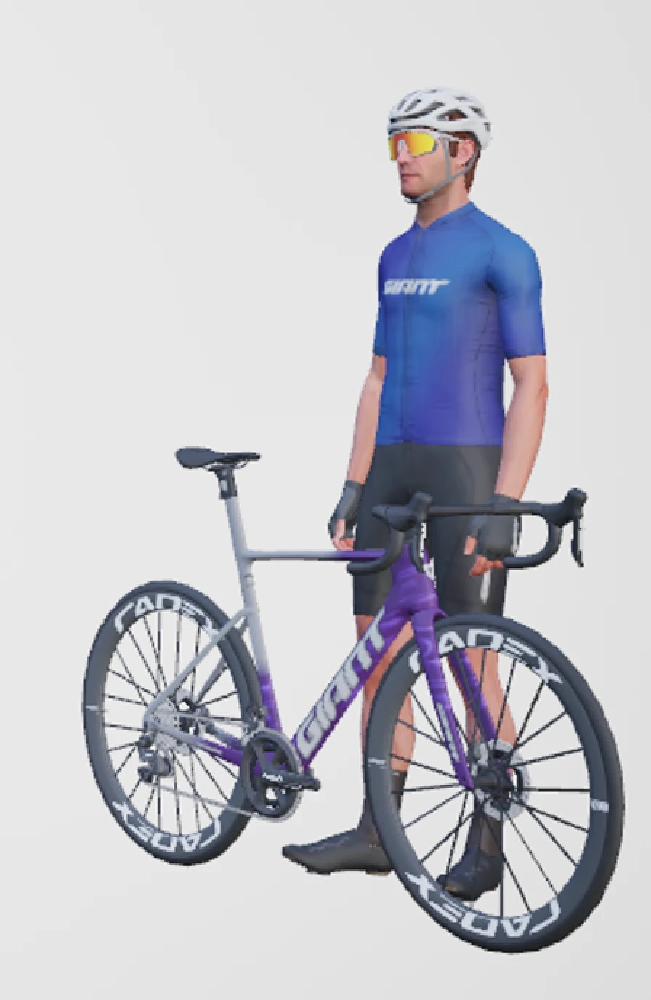 | 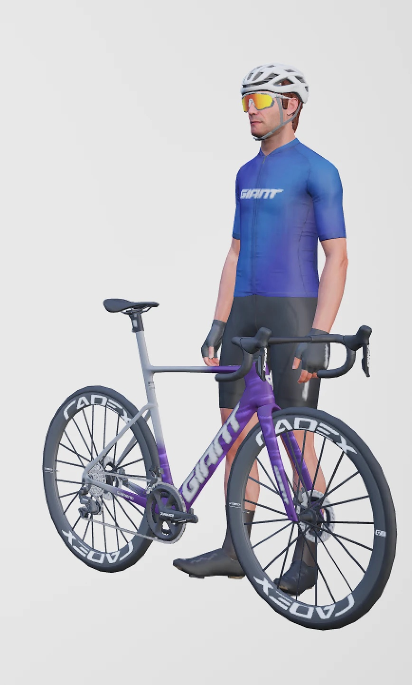 |
| 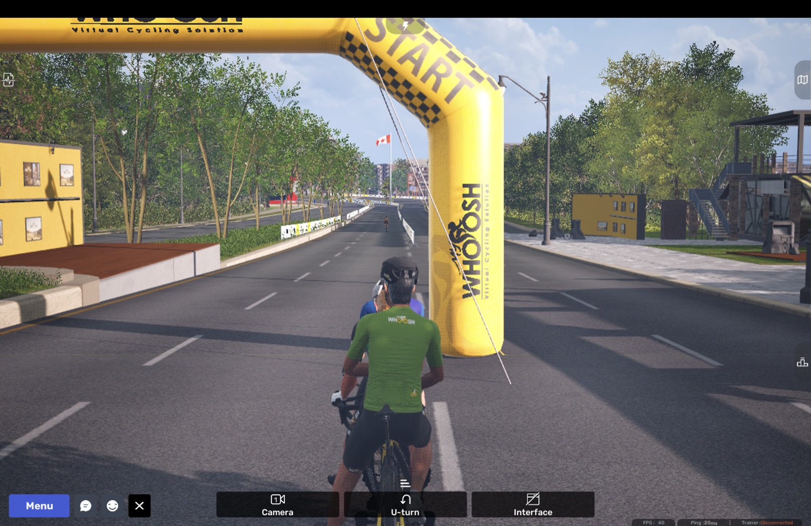 | 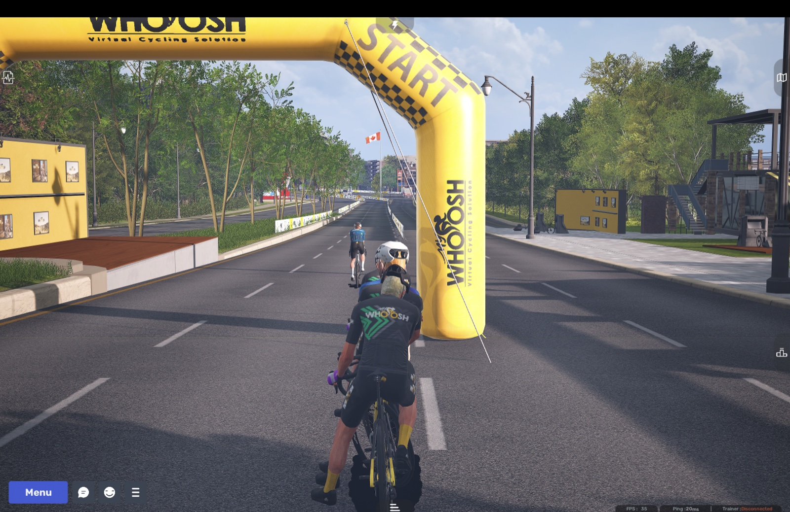 |
| 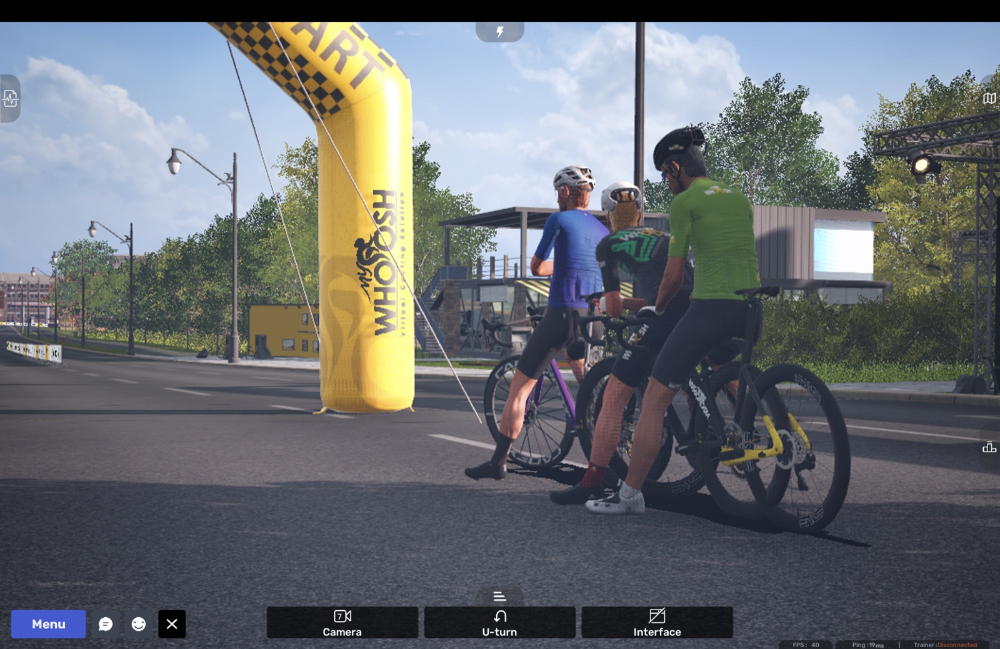 | 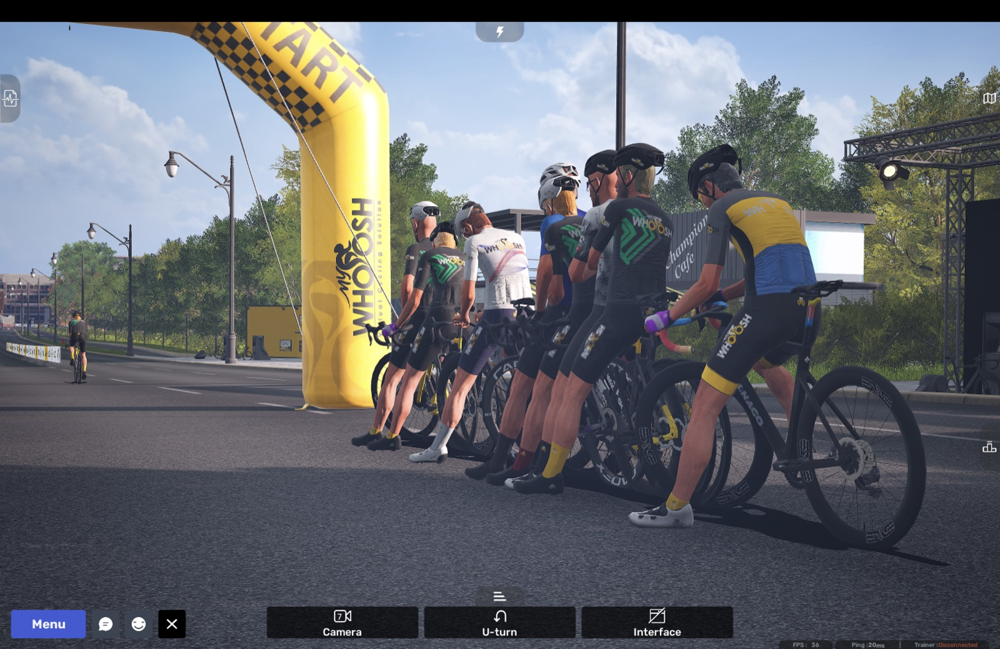 |

## Download

**[Download the latest release (.dmg)](https://github.com/racingDeveloper/pimp-my-whoosh/releases/latest)**, open it and drag Pimp My Whoosh to Applications.

The app isn't signed with an Apple Developer ID yet, so the first time macOS blocks it: open **System Settings › Privacy & Security** and click **Open Anyway**. Then grant it **Full Disk Access** (see [Requirements](#requirements)).

> **Not affiliated with MyWhoosh.** MyWhoosh is a trademark of its respective owner. This is an independent, unofficial tool. It does not modify the game's application bundle, packages or account data: it only writes the user-level configuration files Unreal Engine reads at startup. Use it at your own risk.

## AI disclosure

This project was developed with the help of AI (Anthropic's Claude), including the analysis of how MyWhoosh applies its settings, the code and the translations. Everything was tested and reviewed by humans before release.

## Features

- **Presets**: Max, Balanced, Performance, or the game's own defaults, then fine-tune any setting.
- **47 settings in 8 sections**: quality groups, render resolution and sharpening, frame rate cap and latency, view and shadow distance, effects, lighting, display and window, audio and system.
- **Allowed values only**: every control is limited to the values the engine accepts.
- **The game's value next to each setting**: what MyWhoosh decided on its own (read from its files), or the engine default when the game doesn't set it.
- **Explanations**: what each setting does, what it costs, and how certain it is to have an effect in MyWhoosh (guaranteed / depends on the route / experimental).
- **Search** across all settings, a **preview** of exactly what will be written, automatic **backups** before each write.
- **Launch MyWhoosh** with one click (⌘R), so the settings are always in place when the game starts.
- English and Italian.

## Requirements

- macOS 13 Ventura or later, Apple Silicon or Intel.
- MyWhoosh from the Mac App Store, launched at least once.
- **Full Disk Access** for Pimp My Whoosh. macOS protects other apps' data, and MyWhoosh's configuration lives in its sandbox container. Grant it in System Settings › Privacy & Security › Full Disk Access; the app shows a shortcut when the permission is missing.

## Build

Only the Xcode Command Line Tools are needed (`xcode-select --install`); Xcode itself is not.

```bash
./build.sh
open "build/Pimp My Whoosh.app"
```

The build is a universal binary with an ad-hoc signature, fine for running on your own Mac. If you download a build made by someone else, macOS Gatekeeper will block it until it's signed with a Developer ID and notarized; you can still allow it from System Settings › Privacy & Security › Open Anyway.

To run the tests (the `.ini` writer, the settings catalog and translation coverage): `./test.sh`.

To regenerate the icon: `swift scripts/make_icon.swift`.

## How it works

Findings from analysing MyWhoosh 6.2.3 (Unreal Engine 5.6) on macOS:

- **The game re-applies its own settings at every launch.** It always forces VSync on and a **40 FPS cap**, then applies the menu presets saved in its save game, or picks them from a CPU benchmark on first run.
- **The menu tops out below the engine's maximum.** MyWhoosh's "High" is Unreal's scalability level 3 (Epic); level 4 (Cinematic) is only reachable from the config files.
- **`[SystemSettings]` in `Engine.ini` wins.** Values there have a higher priority than the ones the game sets through its settings API, so they stick (for the forced 40 FPS cap this comes from static analysis: check the in-game stats). But the game **removes that section when it quits**, which is why Pimp My Whoosh rewrites it right before every launch.
- **The game isn't Retina-aware.** It renders at the logical resolution and macOS scales it up ×2. Raising `r.ScreenPercentage` above 100% (supersampling) is the biggest sharpness improvement.
- **None of the exposed engine variables is cheat-only or read-only** in the shipping build, and MyWhoosh's C++ code never sets them directly (its Blueprint scripts are encrypted and couldn't be checked).
- Some settings only matter if a route actually uses the feature (fog, lens flares, film grain…): the game's content is encrypted, so the app marks those as "depends on the route".

Files touched, all inside `~/Library/Containers/com.whoosh.whooshgame/Data/`:

| File | What |
|---|---|
| `…/Saved/Config/Mac/Engine.ini` | `[SystemSettings]`, `[/Script/Engine.UserInterfaceSettings]`, `UnfocusedVolumeMultiplier` in `[Audio]` |
| `…/Saved/Config/Mac/GameUserSettings.ini` | window mode and HDR keys, only when you set them |
| `Library/Preferences/com.whoosh.whooshgame.plist` | `NSAppSleepDisabled`, only when you set it |
| `…/Saved/SaveGames/GameData.sav` | **read-only**, and only to look up the menu's Render Scale value |

A `.pimpmywhoosh.bak` copy of each `.ini` is saved before it's rewritten. A log is kept in `~/Library/Logs/PimpMyWhoosh.log`.

The app never touches power, physics, drafting or anything else that affects rides or competition.

## Translations

English is the development language: the English text is the key. Translations live in `Resources/<lang>.lproj/Localizable.strings`. To add a language, copy `Resources/it.lproj`, translate the values, add the language to `CFBundleLocalizations` in `build.sh`, and check that nothing is missing:

```bash
python3 scripts/extract_strings.py --check Resources/<lang>.lproj/Localizable.strings
```

## Project layout

```
Sources/
  App.swift          app entry point and state
  ContentView.swift  user interface
  Settings.swift     settings catalog, allowed values, presets
  Details.swift      explanations and engine defaults
  GameConfig.swift   reading/writing the game's files, launching the game
Resources/           icon and translations
Tests/main.swift     tests for the .ini writer and the settings catalog
scripts/             string extraction check, icon generator
build.sh             builds the .app with the Command Line Tools
test.sh              runs the tests and the translation check
```

## License

Public domain, under [The Unlicense](LICENSE): use, copy, modify and redistribute it freely, no attribution required.
